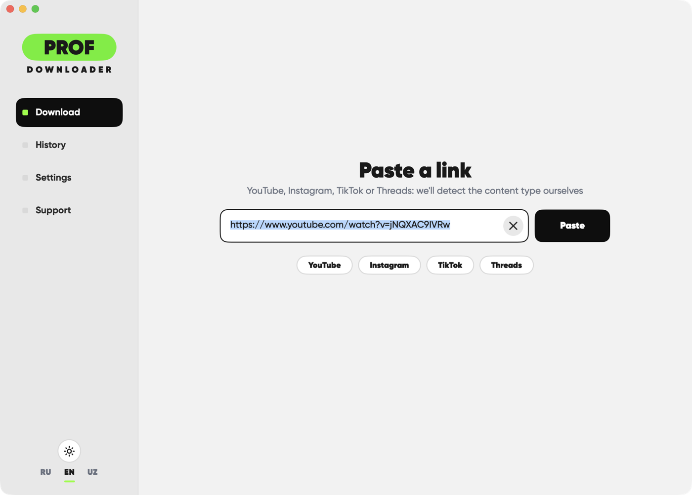
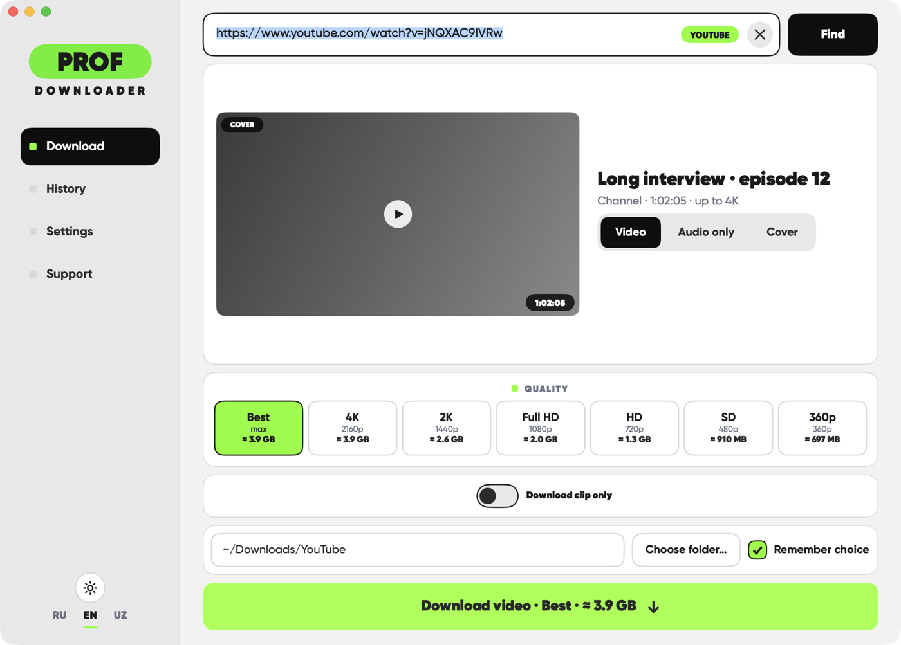
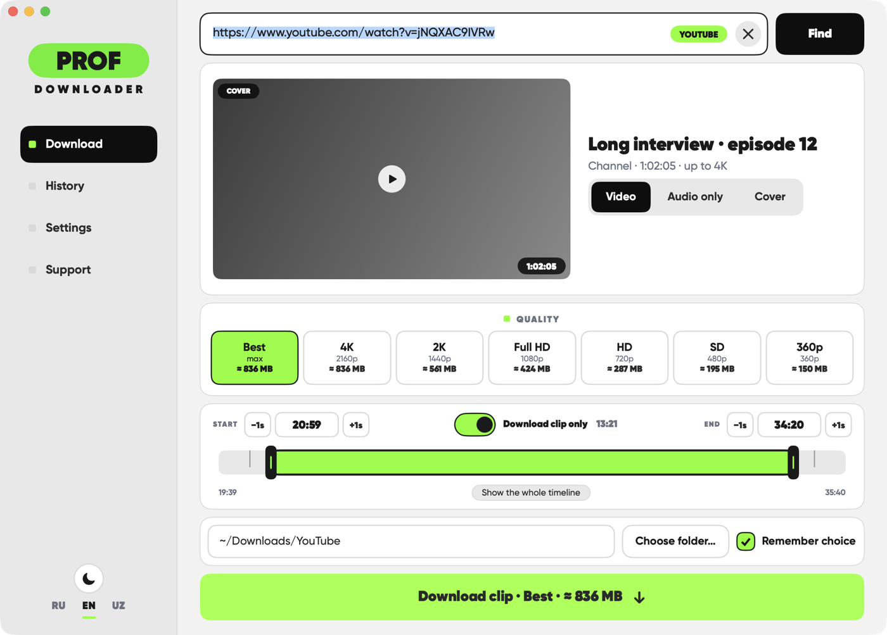
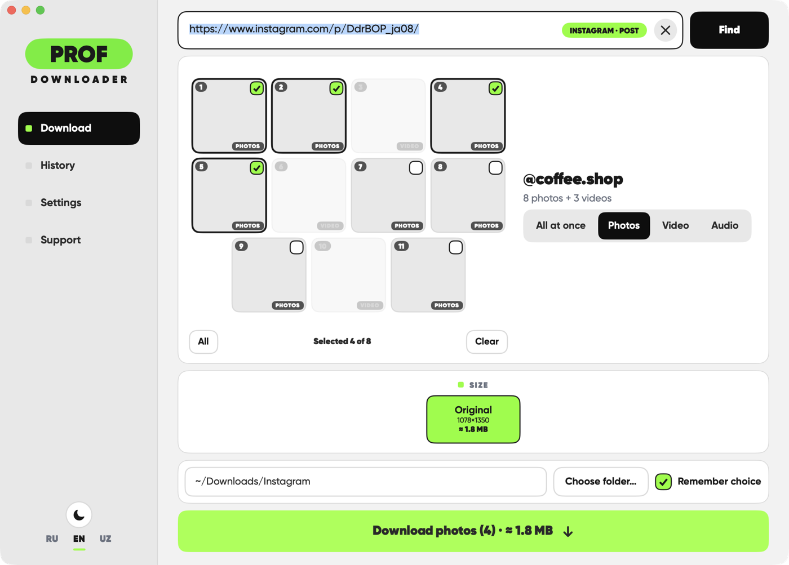
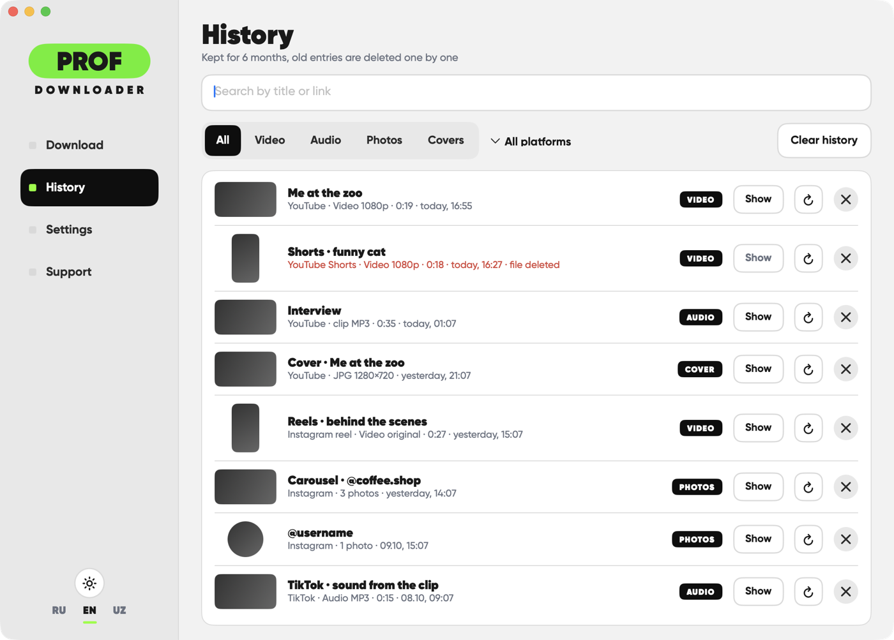
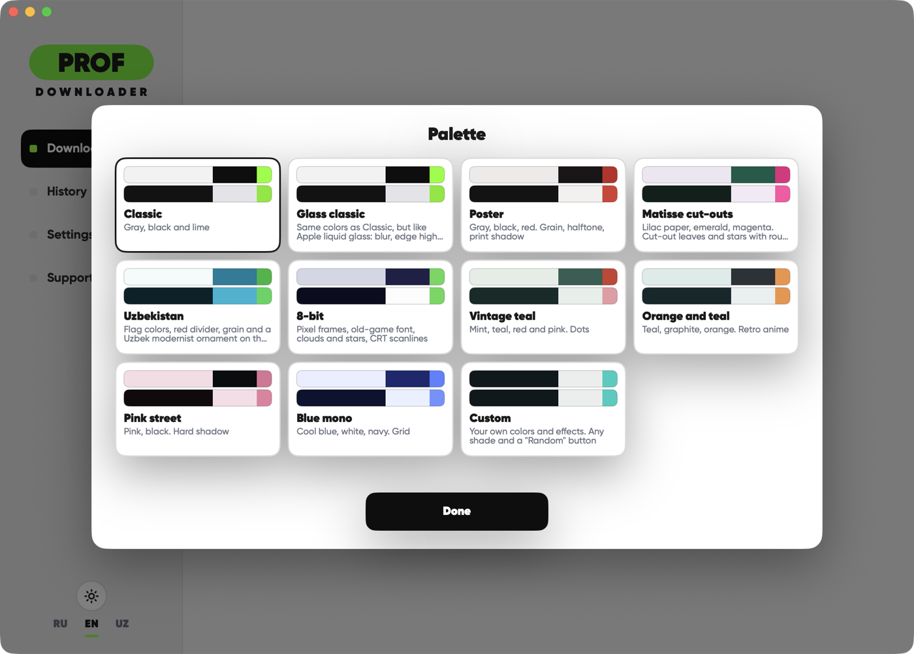

[English](README.md) · Русский

# Prof Downloader

**Вставь ссылку. Получи видео, фото, звук или обложку.**
Без аккаунтов, без водяных знаков, без серверов посередине.

Бесплатное приложение для Mac: сохраняет контент с YouTube, Instagram, TikTok и Threads.
Всё работает на твоём Mac.

<h1 align="center"><a href="https://github.com/terison-brmv/prof-downloader/releases/latest/download/ProfDownloader.zip">⬇ Скачать</a></h1>

Бесплатно · macOS 13+ · Apple silicon · <a href="../../releases/latest">все версии</a> · <a href="../../issues">Вопросы и идеи</a>

> **Сообщить о проблеме или идее?** Пользуйтесь [шаблонами обращений](../../issues/new/choose) и пишите по-английски или по-русски. Без ссылки, версии приложения и версии macOS ошибку трудно воспроизвести.

  
  

  
  

  
  

---

## Что умеет

Вставь ссылку: приложение распознает, что это, покажет превью и предложит нужные варианты: видео в выбранном качестве, только звук, обложку или фото из карусели. Потом сохранит файл в нужную папку.

| Платформа | Что можно сохранить |
|---|---|
| **YouTube** | Видео и Shorts до 4K, только звук, обложки, фрагмент по времени |
| **Instagram** | Рилсы, посты, карусели из фото и видео, фото профиля |
| **TikTok** | Видео, фото-карусели с музыкой, отдельно звук |
| **Threads** | Главный пост ветки (видео, фото) |

## Главное

- **Честная оценка размера.** У каждого качества указан примерный вес до загрузки.
- **Скачать только фрагмент.** Начало и конец перетаскиваются или вводятся точно, шаг ±1 секунда.
- **Выбор нужных фото.** В карусели отметь кадры или забери фото, видео и звук одним нажатием.
- **Умная конвертация.** Если кодек неудобен для QuickTime или монтажных программ, приложение предложит конвертировать.
- **История.** Поиск, фильтры по типу и платформе, показать файл в Finder, повторить загрузку в один клик.
- **Бережно к сервисам.** Встроенные паузы и отдых помогают не упираться в лимиты, а понятные сообщения объясняют, что делать, если сервис блокирует вашу сеть.
- **Всегда свежее.** Движок загрузки и само приложение могут обновляться автоматически (в Настройках это можно отключить).
- **Приватность по умолчанию.** Без аккаунта, входа и аналитики. Ссылки и файлы не покидают твой Mac.

## Сделай под себя

Одиннадцать готовых палитр со светлой и тёмной версиями, плюс **Своя** палитра: выбираешь цвета, шрифты, скругления и эффекты.

Палитра **Glass classic** использует настоящий **Liquid Glass** от Apple, он поддерживается на **macOS 26 и новее**. Остальное приложение работает на macOS 13 и новее.

Интерфейс на **английском, русском и узбекском**, язык можно менять в любой момент.

## Установка

1. Нажми **«Скачать»** выше (или открой [последнюю версию](../../releases/latest) и скачай `ProfDownloader.zip`).
2. Распакуй и перетащи **Prof Downloader** в «Программы».
3. При первом запуске macOS может сказать, что приложение от неизвестного разработчика. Нажми на нём правой кнопкой, выбери **«Открыть»**, потом ещё раз **«Открыть»**. (Или: Системные настройки → Конфиденциальность и безопасность → **«Всё равно открыть»**.)

**Требования:** Mac с Apple silicon и macOS 13 или новее.

## Как это работает

Внутри приложение управляет двумя открытыми инструментами: **yt-dlp** (находит и забирает файл) и **FFmpeg** (склеивает, вырезает, конвертирует), всё это в нативном интерфейсе SwiftUI. Всё выполняется локально.

## Важно знать

Сохраняйте только то, на что у вас есть право, уважайте условия сервисов и труд авторов. Часть контента (закрытые аккаунты, контент с возрастным ограничением или удалённые посты) нельзя скачать без входа, а приложение ваши аккаунты не использует.

## Обратная связь

Нашли ошибку или есть идея? Откройте [обращение](../../issues). Короткое описание со ссылкой и скриншотом помогает больше всего.

## Конфиденциальность

Без аккаунтов, аналитики и слежки. Короткая [заметка о приватности](PRIVACY.md) (на английском).

## Автор и лицензия

Сделал **terison_brmv**. Бесплатно, все права защищены: см. [LICENSE](LICENSE) (юридически действует английский текст). Менять, перепродавать и распространять приложение без разрешения автора нельзя. Сторонние открытые компоненты: [заметки о них](THIRD-PARTY-NOTICES.md).
